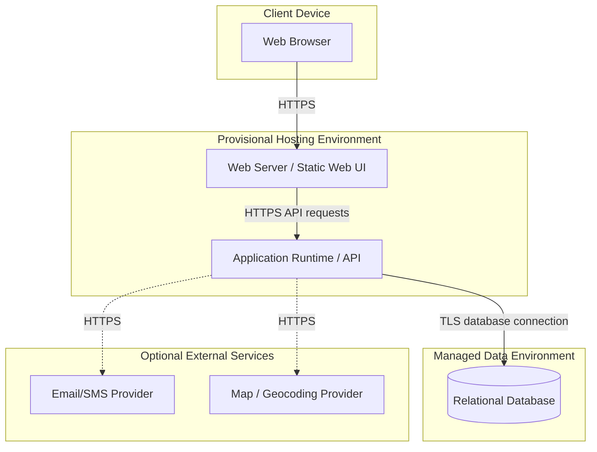

# 10. Provisional Deployment Diagram — Water Watch

**Provisional:** hosting provider, runtime, database product, and exact network configuration have not been selected. Confirm these with the team before treating this as a final deployment design.
