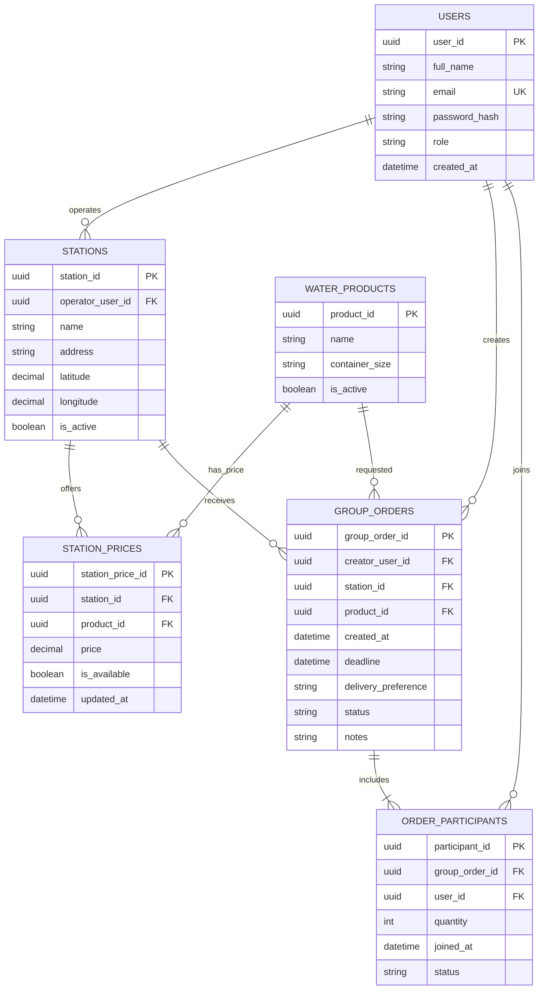

# 11. Entity Relationship Diagram — Water Watch

**PII note:** `USERS.full_name` and `USERS.email` are personally identifiable information. `password_hash` is sensitive security data and must never be displayed in ordinary UI or logs. Apply suitable access controls and retention rules.
