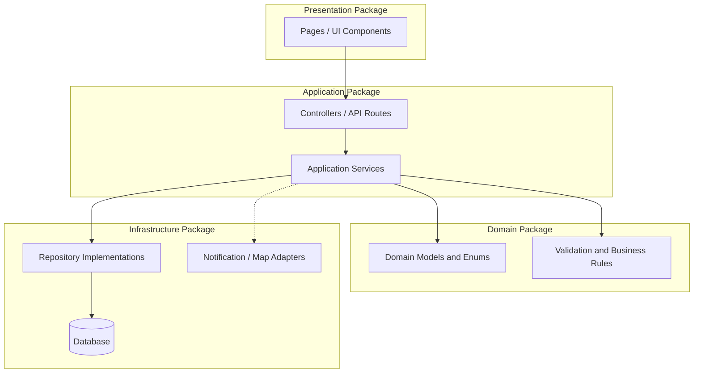

# 8. Package Diagram — Water Watch

**Layering rule:** Presentation code must call application services; it must not access the database directly. Domain rules should not depend on UI or database implementation details.
