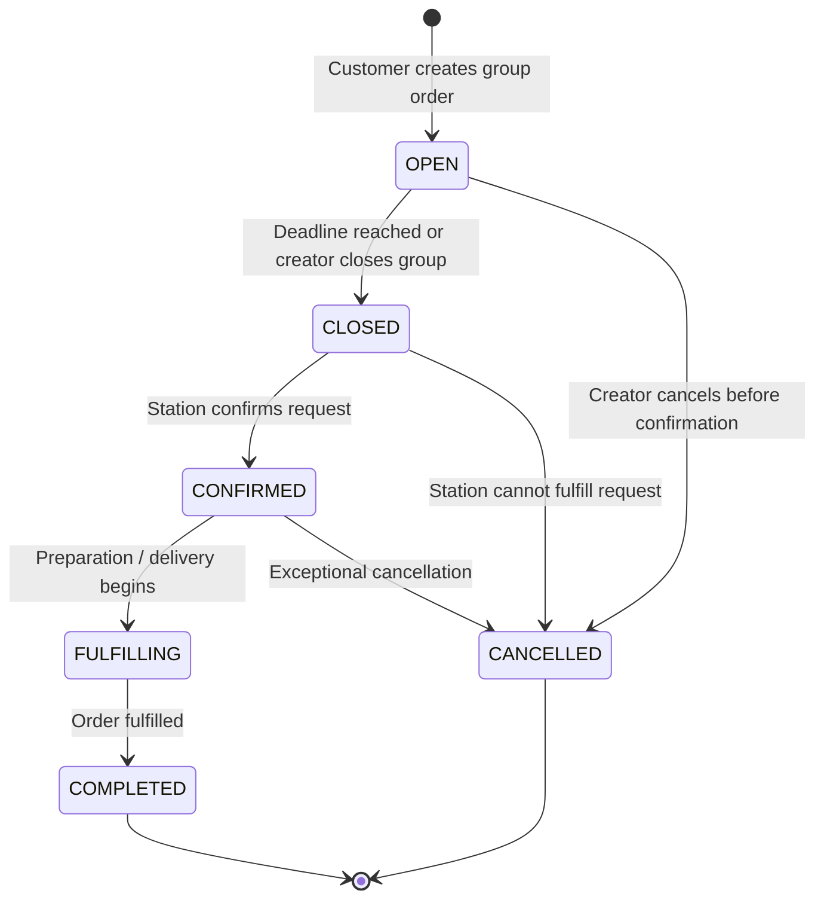

# 7. State Machine Diagram — Group Order

`OrderStatus` values here should match the class diagram. If the team decides that a station cannot cancel after confirmation, remove that transition and document the actual rule.
